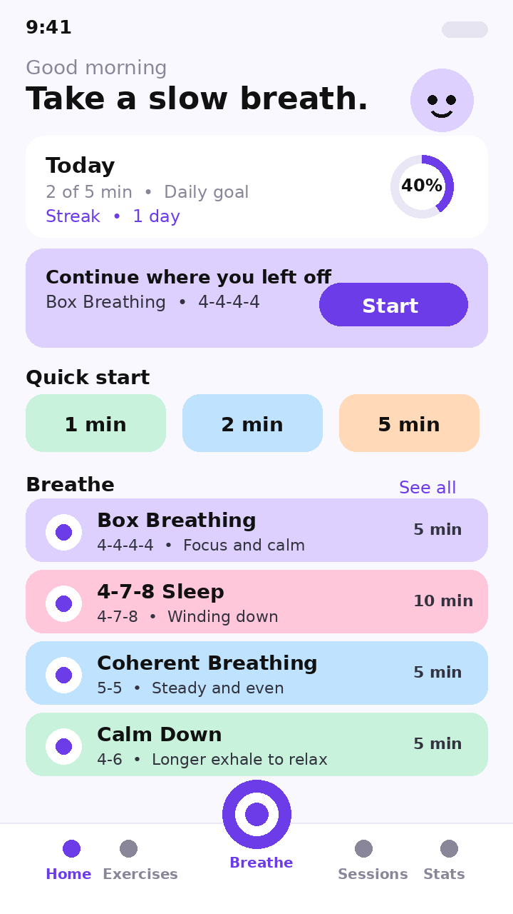

# Aevlo: Breathe slower, feel calmer

Aevlo is a breathing trainer for slowing down, relaxing before sleep, or resetting during a stressful day. Pick an exercise or a calming session, follow the circle, and finish calmer in a few minutes. No account, no ads, no internet needed.

## What it does

- 6 guided breathing exercises, each with a paced animated circle, phase-by-phase inhale, hold and exhale timing, countdown and round count:
  - Box Breathing 4-4-4-4, for focus and calm
  - 4-7-8 Sleep 4-7-8, for winding down
  - Coherent Breathing 5-5, steady and even
  - Calm Down 4-6, longer exhale to relax
  - Energising Breath 3-3, brisk pace
  - Belly Breathing 4-2-4, slow and deep
- 3 calming sessions with a settle-in, main pace and gentle close:
  - Quick Calm, 2 minutes, Box Breathing pace, no ambient sound
  - Deep Calm, 5 minutes, slow 4-6 pace, soft rain
  - Sleep Wind Down, 10 minutes, 4-7-8 pace, low warm drone, screen dims gradually
- Session player with pause and resume, skip phase, end early (saves the minutes actually completed), session length picker (1, 2, 3, 5 or 10 minutes, or by rounds), and a calm rating from 1 to 5 after each session.
- Custom breathing patterns: name one, pick a pastel colour, set inhale, hold, exhale and hold in seconds (1 to 12 each), plus default rounds or minutes. Edit, duplicate or delete any pattern. Deleted patterns go to Trash with restore for 30 days.
- History and stats: current streak, total minutes breathed, total sessions, favourite exercise, a weekly bar chart of minutes per day for the last 7 days, and a calm trend over the last 14 days. History is searchable, filterable and sortable.
- Daily practice: a daily goal in minutes, a today progress ring and streak count, and gentle reminders at up to two times of day. Reminders are local only and are never guaranteed if the app is fully closed, because there is no server.
- Calm synthesised sounds and haptics, made in code with Web Audio, no sound files: soft pops, chimes, rain, ocean waves and a low warm drone. Sound, haptics, spoken phase cues and Reduce Motion can all be turned on or off in Settings.
- Lavender, white and purple design with pastel cards and SVG blob mascots.
- Works fully offline. All data is stored only on the device, in local storage. No account, no server, no tracking.

## Honest limits

- Aevlo measures nothing about the body. It does not measure heart rate, stress level or sleep quality, and it has no sensor access. The only measure is your own calm rating after a session.
- If you feel dizzy or lightheaded, stop and breathe normally. This app is for general wellness only. It does not diagnose, treat or cure any condition, and it is not medical advice.
- Reminders are local only, as noted above.
- The 3 sample history entries included on first open are clearly marked as samples and are fully deletable. Streak and totals start from those samples only, and reset to true zero when the samples are deleted.

## Status

Working prototype, built November 2026. A signed Android APK also exists (Aevlo.apk, 69K, package com.yashdashrath.aevlo, debug-signed, targetSdk 35). No Play Store claim.

## Showcase only

This repository is a showcase. It contains no source code and no build files, and nothing here is open source. The screenshot(s) above are showcase images only. See NOTICE.md.

## Contact

Built by Yash Dashrath, Pune, India.

- Email: yashdashrath18@gmail.com
- LinkedIn: https://www.linkedin.com/in/yash-dashrath
- Yash MediaWorks: https://www.linkedin.com/company/yashmediaworks/
